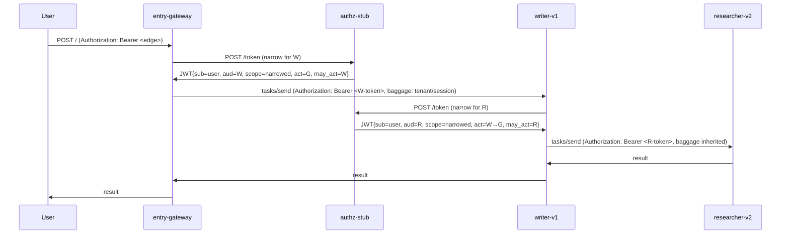

# exercise-02: Identity and Permission Propagation

**Estimated effort:** 3.5 hours · **Output:** a two-agent A→B topology with full identity delegation via RFC 8693 token exchange, three deliberate security faults (token replay, pass-through without exchange, cross-tenant), per-fault conformance assertions, a Mermaid sequence diagram of the delegation chain, and a short README (~1 page) · **Pairs with:** chapter [04](../04-identity-delegation-and-permission-scope-propagation.md); feeds exercise 03 and project 401 / 402.

## Objective

Stand up two A2A agents — `writer-v1` (caller) and `researcher-v2` (callee) — and wire RFC 8693 token exchange, SPIFFE-shaped workload identity, scope narrowing against the callee's AgentCard, and baggage-based tenant propagation end to end. Then deliberately violate each of the three security invariants chapter 04 pinned and capture the resulting rejection.

A plane that cannot demonstrate identity propagation under adversarial conditions is a plane that will leak privilege in the first production incident. The exercise targets that.

## Prerequisites

- You have completed [exercise 01](exercise-01-a2a-spec-conformance-walkthrough.md). The conformance test runner and the stub A2A server from that exercise are the starting point.
- You have read chapters [01](../01-the-a2a-plane-and-what-it-owns.md), [02](../02-the-a2a-protocol-and-service-mesh-mapping.md), [03](../03-inter-agent-routing-and-service-discovery.md), and especially [04](../04-identity-delegation-and-permission-scope-propagation.md).
- You have [RFC 8693](https://datatracker.ietf.org/doc/html/rfc8693) open in a tab, particularly §2 (the token-exchange request/response) and §4.1 (`act` and `may_act` claims).
- You have a JWT library for your language — [`PyJWT`](https://pyjwt.readthedocs.io/) in Python, [`jose`](https://github.com/panva/jose) in TypeScript, [`golang-jwt`](https://github.com/golang-jwt/jwt) in Go.
- You have [`uv`](https://docs.astral.sh/uv/) / `npm` / `go mod` set up as appropriate for the language you used in exercise 01.

## Problem statement

Build the delegation chain described in chapter 04:

```
User → entry-gateway → writer-v1 → researcher-v2
```

where every hop carries a narrowed JWT with the end-user subject preserved, an `act` chain naming each delegator, a `may_act` claim binding the token to the next audience, and a scope that is the intersection of the caller's scope with the callee's AgentCard `platform.declared_scopes`.

Then show that the chain enforces its invariants: a replayed token from a different workload is rejected, a pass-through of an un-narrowed token is rejected, and a cross-tenant call without an allowlist entry is rejected.

Real OAuth 2.0 authorisation servers (Keycloak, Ory Hydra) with full RFC 8693 support are available but take time to set up. For this exercise you may use a **stub authorisation server** — a small HTTP service that mints and verifies JWTs with a static signing key. The stub implements RFC 8693's token-exchange endpoint and nothing else. Chapter 04's cautions about production authz-server availability still apply; your stub is a learning tool.

## Requirements

### Part 1 — The stub authorisation server

Implement a minimal `authz-stub` service (one file, 100–200 LOC) that exposes:

- `POST /token` with `grant_type=urn:ietf:params:oauth:grant-type:token-exchange` handling (RFC 8693 §2).
- A static signing key (RS256 or ES256; symmetric is tempting but makes the mTLS story harder to extend later).
- A JWKS endpoint `GET /.well-known/jwks.json` publishing the public key.

Token-exchange behaviour:

- Verify the `subject_token` using the stub's signing key.
- Require `subject_token_type = urn:ietf:params:oauth:token-type:jwt`.
- Require `audience` in the request to be a declared agent workload id (your stub can accept any string for the exercise, but validate the shape).
- Require `scope` in the request to be a subset of the subject token's `scope`.
- Mint a new JWT with:
  - `sub` = subject token's `sub` (unchanged).
  - `aud` = the requested `audience`.
  - `scope` = the requested `scope`.
  - `act` = a nested object naming the actor_token's `sub` (or the requester's own identity, if no actor_token).
  - `may_act` = `{"sub": <audience>}`.
  - `exp` = now + 300.
  - Preserve any `platform.tenant_id` / `platform.session_id` claims.

### Part 2 — The entry gateway

A minimal HTTP service that:

- Accepts a user request on `POST /`.
- Reads an initial bearer token on `Authorization` — for the exercise, you mint this by hand with a helper script against the same stub-authz signing key, representing the identity provider's edge token.
- Fetches `writer-v1`'s AgentCard, reads `platform.declared_scopes`.
- Requests a narrowed token from the authz stub: `subject_token = edge token`, `audience = writer-v1's workload_id`, `scope = user_scope ∩ writer-v1.declared_scopes`.
- Writes `baggage: tenant_id=<tenant>, session_id=<generated>` on the outbound call to writer-v1.
- POSTs `tasks/send` on writer-v1 with the narrowed bearer and the baggage.

### Part 3 — Two A2A servers with the server scaffold

Extend the exercise-01 stub agent to serve two agents:

- `writer-v1` — AgentCard `declared_scopes = ["read:docs", "write:drafts", "search:web"]`. Skill `draft(topic) -> draft_text`. The handler, as part of drafting, calls `researcher-v2`.
- `researcher-v2` — AgentCard `declared_scopes = ["read:docs", "search:web"]`. Skill `research(topic) -> findings_text`.

Each server must, on every inbound A2A call:

- Verify the bearer token's signature using the authz stub's JWKS.
- Verify `aud` matches the agent's workload id (a 403 otherwise).
- Verify `may_act` matches the agent's workload id (a 403 otherwise).
- Extract the delegation chain from the `act` nesting; surface it on the request context.
- Verify the invoked skill is covered by the token's scope — e.g., the `research` skill requires `search:web` or `read:docs`.
- Extract baggage (`tenant_id`, `session_id`) and attach to the request context.
- Emit an `A2ACallRecord` (chapter 01) with:
  - `end_user_subject`, `delegation_chain`, `scope_granted`, `scope_narrowed_from`, `caller.workload_id`, `callee.workload_id`, `tenant_id`.

Writer-v1's handler, when it calls researcher-v2:

- Fetches researcher-v2's AgentCard.
- Narrows: `current_scope ∩ researcher_v2.declared_scopes` = `{read:docs, search:web}`.
- Requests a new token from the authz stub.
- Builds the outbound request with the new bearer, baggage unchanged from inbound, `traceparent` propagated (even if your trace infrastructure is just prints).
- Honours the deadline convention: reads `x-platform-deadline-ms` from inbound; decrements by elapsed; passes decremented value on outbound; refuses if remaining < 50 ms.

### Part 4 — The green run

Execute the chain:

```sh
# Mint an edge token
./scripts/mint_edge_token.py \
  --sub user:test01 \
  --scope "read:docs write:drafts search:web send:email" \
  --tenant-id acme-financial \
  --session-id sess_test01 \
  > edge_token.txt

# Invoke
curl -X POST http://localhost:7000/ \
  -H "Authorization: Bearer $(cat edge_token.txt)" \
  -H "Content-Type: application/json" \
  -d '{"topic": "quarterly outlook"}'
```

Capture every `A2ACallRecord` to `green.records.jsonl`. Walk the file and assert (automated in `check_green.py` or equivalent):

- **Two records** — one for the entry→writer call, one for the writer→researcher call.
- **Both records share `trace_id` (if you wired traceparent) and `end_user_subject`.**
- **The writer→researcher record has `scope_narrowed_from = ["read:docs", "write:drafts", "search:web"]` and `scope_granted = ["read:docs", "search:web"]`.** Note: `send:email` never reached writer-v1 because the entry gateway narrowed it out; the narrowed-from here is writer-v1's inbound scope.
- **The `delegation_chain` on the writer→researcher record contains `["entry-gateway", "writer-v1"]`** (the researcher being called is the destination, not a chain element).
- **Both records have `tenant_id = "acme-financial"` on baggage.**
- **The deadlines are decremented** — writer sees a lower `x-platform-deadline-ms` than entry sent; researcher sees lower still than writer sent.

### Part 5 — Three deliberate security faults

For each fault, implement the fault, run the chain, capture the rejection, and author a `check_fault_<N>.py` assertion. Each fault should produce a *clean rejection*, not a crash or a silent pass.

#### Fault A — Token replay by a different workload

Capture the token writer-v1 minted for researcher-v2 (log it in your writer handler as a debug aid). In a separate script, replay the token from a *different* workload identity to researcher-v2. Researcher-v2 must reject because the `may_act` claim does not match the replayer's SVID.

Since this exercise does not have a real mesh with mTLS, simulate the SVID check by having researcher-v2's scaffold read a header `x-workload-id` the client asserts. The replayer sets `x-workload-id` to its own (different) id; researcher-v2 compares against `may_act.sub` and rejects. Document this stub clearly in the README.

`check_fault_a.py` asserts:
- The response is a 403 (or JSON-RPC authorisation error).
- The error message names `may_act_mismatch` or equivalent.
- An `A2ACallRecord` is still emitted with `outcome = "unauthorised"`.

#### Fault B — Pass-through of an un-narrowed token

Modify writer-v1's handler to skip the token exchange and send its inbound token directly to researcher-v2. Researcher-v2 must reject because `aud` is writer-v1, not researcher-v2.

`check_fault_b.py` asserts:
- The response is a 403.
- The error message names `audience_mismatch` or equivalent.

#### Fault C — Cross-tenant call without allowlist

Add a third agent `secret-analyst-v1` in a different tenancy on the AgentCard (`platform.tenancy = "bigco"`). The registry declares no `cross_tenant_allow` for `acme-financial`. Have writer-v1's handler attempt to call `secret-analyst-v1`. The call must be rejected at the registry lookup (your writer scaffold's responsibility — before any token minting).

`check_fault_c.py` asserts:
- Writer-v1's handler receives a `CrossTenantDenied` error from the scaffold.
- No token-exchange request reached the authz stub (verify by inspecting the authz stub's request log).
- No HTTP request reached `secret-analyst-v1` (verify by inspecting its request log; the server need not be running for this fault, but log any attempt).

### Part 6 — The Mermaid diagram

Produce a Mermaid sequence diagram in the README:



Call out in prose:

- Which claim the scaffold reads at each check (`aud`, `may_act`, `scope`, `act`).
- Which step the authz stub performs the narrowing.
- Which baggage entries propagate vs. which are per-hop (`tenant_id` propagates; the token's `aud` changes per hop).

### Part 7 — The README

One page covering:

- Services (authz-stub, entry-gateway, writer-v1, researcher-v2). How to run them. The commands to produce `green.records.jsonl` and each of the three fault captures.
- The Mermaid diagram with prose call-outs.
- The six green-run assertions and how `check_green.py` verifies them.
- The three faults, with a one-paragraph explanation each: what you broke, what rejected it, what the audit record looked like.
- One "I was surprised by" observation — e.g. "the `may_act` claim does most of the work; without it, the token-replay check would need to be re-done at every scaffold instead of at the authz server."
- One open question for exercise 03 — e.g. "if the authz server itself goes down mid-chain, should writer-v1 fail-fast or serve from a cached recent token?"

## Starter guidance

- **Use the same signing key for your stub authz.** Rotation is a mod-406 / 410 problem, not a mod-409 one.
- **Log everything.** Every token minted (claims, redacted signature), every token verified, every rejection — stdout or a file. You will spend most of the exercise debugging why a claim is unexpected.
- **Decode tokens at `https://jwt.io` when you are stuck.** Paste the token; look at the claims; find the mismatch.
- **Keep the scopes short.** Three or four scopes across the exercise are plenty; the narrowing logic is clearer when you can see the set in one line.
- **Stub the SVID check cleanly.** A header-based `x-workload-id` stub is fine, but document it in the README and make clear it is a simulation of the mesh's mTLS binding.
- **Check `aud`, `may_act`, `scope`, `delegation_chain`, `tenant_id`, `deadline` in the scaffold's *middleware*, not in the handler.** The handler sees a clean request context. If a check leaks into the handler, you are re-inventing the problem on every new skill.

## Acceptance criteria

Mark done when:

- [ ] All four services (authz-stub, entry-gateway, writer-v1, researcher-v2) run with one `docker compose up` (or equivalent) and the green `curl` succeeds.
- [ ] `check_green.py` asserts the six green-run invariants and passes.
- [ ] All three fault scenarios run and `check_fault_a/b/c.py` assert the rejection correctly.
- [ ] The Mermaid diagram matches the actual call sequence; prose names which claim does what.
- [ ] Every record in `green.records.jsonl` and the fault captures carries `end_user_subject`, `delegation_chain`, `scope_granted`, `scope_narrowed_from`, `caller.workload_id`, `callee.workload_id`, `tenant_id`, `outcome`.
- [ ] The scaffold enforces checks in middleware; handler code does not inspect tokens.
- [ ] No service treats baggage as a trust boundary (verify by grepping the code — authorisation decisions read the token, not baggage).

## Stretch goals

- **Replace the stub authz with Keycloak or Ory Hydra.** Both support RFC 8693. The exercise becomes a lot more real; some claim names (`act`, `may_act`) may need to be mapped to provider-specific fields.
- **Add real mTLS with a local SPIFFE SPIRE deployment.** [SPIRE's quick start](https://spiffe.io/docs/latest/try/getting-started-k8s/) walks a local setup. Writer-v1 and researcher-v2 get real SVIDs; the `may_act` check now compares against the TLS peer, not a stub header.
- **Add a fourth agent for a legitimate cross-tenant call.** Update the registry's `cross_tenant_allow`; verify the mesh and scaffold both permit; verify the `A2ACallRecord` carries `cross_tenant: true` and lands on a separate audit stream.
- **Add a handoff** — writer-v1 hands off to researcher-v2 instead of calling it. The session-affinity record changes; the second user turn goes to researcher-v2. The scope narrowing is different (chapter 06's handoff section covers this).
- **Add token caching at the scaffold.** Writer-v1 fanning out to five subagents with the same `(subject, audience, scope)` should hit a single token-exchange call per combination per lifetime. Measure the reduction in authz-stub requests.
- **Inject a clock-skew failure.** Set the authz stub's clock 90 seconds ahead; watch tokens' `nbf` claims reject on the receiving agent. Chapter 03 named this in passing; now you have felt it.
